# Forklift and Pallet Detection

**Real-time object detection for warehouse safety, automation and inventory, built on YOLO11 and served with FastAPI.**


<!-- Add screenshots: assets/demo.png (web demo) and assets/predictions.png (sample predictions) -->

## Table of contents

1. [Overview](#overview)
2. [Key results](#key-results)
3. [Features](#features)
4. [Architecture](#architecture)
5. [Quick start](#quick-start)
6. [API reference](#api-reference)
7. [Data](#data)
8. [Model and training](#model-and-training)
9. [Evaluation](#evaluation)
10. [Performance](#performance)
11. [Project structure](#project-structure)
12. [Reproducing the training](#reproducing-the-training)
13. [Limitations](#limitations)
14. [Roadmap](#roadmap)
15. [Tech stack, licenses and credits](#tech-stack-licenses-and-credits)

## Overview

The system detects **forklifts** and **pallets** (empty or loaded) in warehouse images and returns, for every object, a class, a bounding box and a confidence score.

| Use case | What the detector enables |
| --- | --- |
| Safety | Warn when a forklift enters a walking zone |
| Automation | Guide autonomous forklifts to the right pallet |
| Inventory | Count pallets without manual stock checks |
| Efficiency | Measure forklift use and dock activity |

The problem is framed as **object detection** (what is where) rather than classification or segmentation: boxes are enough for counting, zones and tracking, and they are far cheaper to label.

The project covers the full path from raw public datasets to a working service: data auditing and filtering, leakage-aware splits, class-imbalance handling, model comparison, honest evaluation, ONNX export and a live demo.

## Key results

Held-out test set (187 images). The model and every threshold were chosen on validation; the test set was used once.

| Metric | Value |
| --- | --- |
| Model | YOLO11s, COCO-pretrained, 768 px |
| mAP@50 / mAP@50-95 | **0.863 / 0.540** |
| Precision / Recall | 0.826 / 0.793 |
| Forklift AP@50 / mAP@50-95 | 0.902 / 0.631 |
| Pallet AP@50 / mAP@50-95 | 0.823 / 0.450 |
| Forklift/pallet confusions | 0 |
| CPU latency (ONNX, batch 1) | 210 ms per image (4.8 FPS) |

## Features

- **Detector:** YOLO11s fine-tuned for two classes, exported to ONNX.
- **Web demo:** drag-and-drop upload of one or many images, model selector (`.pt` or `.onnx`), confidence slider with live preview, per-class counts and inference time, light and dark theme.
- **REST API:** FastAPI endpoints for prediction, model listing, history and health, with interactive docs at `/docs`.
- **Audit trail:** every saved run writes an annotated image, a JSON file with all detections, a CSV log and an HTML report.
- **Reproducible pipeline:** data preparation, training, evaluation and export in one notebook, with a fixed seed.

## Architecture

```mermaid
flowchart LR
    A[Two public datasets] --> B[Filter to forklift and pallet<br/>validate and audit labels]
    B --> C[Train / valid / test split<br/>near-duplicate check]
    C --> D[Imbalance handling]
    D --> E[Train YOLO11n and YOLO11s]
    E --> F[Select on validation,<br/>test once]
    F --> G[ONNX export]
    G --> H[FastAPI service]
    H --> I[Browser UI and results/ folder]
```



## Quick start

Requirements: Python 3.10 or newer. No GPU is needed for the demo.

```bash
git clone <repository-url>
cd <repository-folder>

python -m venv venv
venv\Scripts\activate          # macOS/Linux: source venv/bin/activate
pip install -r requirements.txt
```

Place the trained weights in `models/` as `best.pt` and/or `best.onnx` (exported by the notebook as `yolo11s_best.pt` and `yolo11s_best.onnx`). Then start the server:

```bash
uvicorn app:app --reload
```

Open http://127.0.0.1:8000 for the UI or http://127.0.0.1:8000/docs for the API documentation.

### Using the demo

1. Drop one or more images on the page. New uploads are processed and saved automatically.
2. Pick a model and move the confidence slider to preview other thresholds (previews are not saved).
3. Press **Run & save to results** to store the current setting.
4. Open the full report from the **Recent results** panel.

Saved runs are written to `results/`:

```
results/
├── summary.csv                      # one row per saved image
├── report.html                      # totals and thumbnails
└── <timestamp>_<image>/
    ├── original.jpg
    ├── annotated.jpg
    └── detections.json              # label, confidence and box for every detection
```

## API reference

| Method | Path | Description |
| --- | --- | --- |
| GET | `/` | Web UI |
| GET | `/health` | Status, available models, default model, image size, device |
| GET | `/models` | Available model files and the default |
| GET | `/history?limit=8` | Most recent saved runs |
| POST | `/predict` | Detect objects in one image |
| GET | `/docs` | Interactive OpenAPI documentation |

`POST /predict` takes a multipart form: `file` (image), `conf` (default `0.35`), `model` (file name from `/models`) and `save` (default `false`).

```bash
curl -X POST http://127.0.0.1:8000/predict \
  -F "file=@warehouse.jpg" -F "conf=0.35" -F "model=best.onnx" -F "save=false"
```

```json
{
  "width": 1280, "height": 720, "ms": 210.4, "model": "best.onnx",
  "detections": [
    {"label": "forklift", "conf": 0.9, "box": [152.0, 71.3, 255.8, 266.0]}
  ],
  "saved": null
}
```

Boxes are `[x1, y1, x2, y2]` in original image pixels. Inference uses 768 px input and an NMS IoU of 0.7, the values tuned on validation.

## Data

| Source | Images | Classes | Notes |
| --- | --- | --- | --- |
| Warehouse dataset (Roboflow Universe) | 1,075 | forklift, pallet, pallet_truck, small_load_carrier, stillage | 11,776 pallet boxes but only 5 forklift boxes in train |
| Forklift dataset (Kaggle) | 1,011 | forklift, person | 1,000 forklift boxes in train, no pallets |

Final dataset: **1,660 train / 213 validation / 187 test** images.

| Split | Images | Forklift boxes | Pallet boxes |
| --- | --- | --- | --- |
| train | 1,660 | 905 | 10,347 |
| validation | 213 | 96 | 1,480 |
| test | 187 | 100 | 1,118 |

About 70% of all boxes cover less than 1% of the image, so small objects dominate.

**Filtering rules** (the source datasets are never modified):

- Only `forklift` and `pallet` are kept. Class names are matched exactly, so `pallet_truck` is never mistaken for `pallet`.
- Boxes of removed classes (11,836 in total) become background, so the model learns they are neither forklifts nor pallets.
- Images with only removed classes are kept as hard negatives, capped at 80 images.
- Images with empty or missing labels, or unreadable files, are dropped (3 images).
- Polygons are converted to YOLO boxes, and the finished dataset is re-read from disk and verified.
- Audit sheets and CSV reports are produced for visual review.

**Split hygiene.** Near-identical frames are grouped with a difference hash so they stay together, and a near-duplicate check runs across the splits (none needed removal in the final run). This prevents a test twin of a training image from inflating the score.

**Data problems and how they are handled**

| Problem | Evidence | Handling |
| --- | --- | --- |
| Class imbalance | About 12 pallet boxes per forklift box (13,275 and 1,101) | Forklift images repeated up to 3 times (3,324 train images, 2,715 forklift boxes), class-weighted loss (power 0.5), per-class evaluation |
| Labels missing across sources | The forklift dataset has no pallet labels, the warehouse dataset has 5 forklift labels | Errors reported per source. Pseudo-labelling is implemented in the notebook but switched off in the final run |

Validation and test labels are never modified.

## Model and training

- **Architecture:** Ultralytics YOLO11, a single-stage anchor-free detector, fine-tuned from COCO weights. YOLO11n is the lightweight baseline and YOLO11s is compared against it.
- **Settings:** 768 px, up to 60 epochs with early stopping (patience 20), cosine learning rate, mosaic off for the last 10 epochs, no vertical flip, class-weighted loss, seed 42.
- **Hardware:** Tesla T4. Training took 39 minutes (YOLO11n) and 58 minutes (YOLO11s).
- **Selection protocol:** the model, the NMS IoU (0.5 to 0.8 tried, 0.7 best) and the confidence threshold (0.35, best F1) are chosen on validation only.
- **Test-time augmentation** raised validation mAP@50-95 from 0.491 to 0.507 but more than doubled inference time, so it is not used.
- An `accurate` preset (960 px, 100 epochs) is available in the notebook for small-object accuracy.

## Evaluation

| Model | Split | mAP@50 | mAP@50-95 | Precision | Recall |
| --- | --- | --- | --- | --- | --- |
| YOLO11n | val | 0.830 | 0.476 | 0.855 | 0.773 |
| YOLO11n | test | 0.875 | 0.548 | 0.869 | 0.806 |
| **YOLO11s** | val | 0.838 | 0.491 | 0.867 | 0.778 |
| **YOLO11s** | test | 0.863 | 0.540 | 0.826 | 0.793 |

YOLO11s is selected because it has the higher validation mAP@50-95. On the test set the two sizes are close, which is expected for a set with about 100 forklift boxes.

**Error analysis** (YOLO11s, test, confidence 0.35, IoU 0.5):

| Outcome | Count |
| --- | --- |
| Correct detections | 943 |
| False alarms on background | 273 |
| Missed objects | 275 |
| Forklift/pallet confusions | 0 |

At this operating point precision is 0.775, recall 0.774 and F1 0.775. Recall depends on object size: small pallets (under 0.2% of the image) are found 62.5% of the time, medium ones 83.3% and large ones 86.9%. Missed objects have a median area of 0.19% of the image, against 0.42% for all boxes. Some false alarms are probably real pallets that were never labeled in the source data.

## Performance

Measured on an Intel Xeon 2.0 GHz CPU, batch 1, 768 px.

| Runtime | Latency | FPS | Test mAP@50-95 |
| --- | --- | --- | --- |
| PyTorch | 254 ms | 3.9 | 0.540 |
| ONNX Runtime | 210 ms | 4.8 | 0.532 |

On a Tesla T4 inference takes about 13 ms per image. Latency depends on the hardware, and a laptop CPU is slower than the server CPU above.

## Project structure

```
.
├── app.py                            # FastAPI backend
├── static/index.html                 # demo UI (HTML, CSS, JS)
├── models/                           # best.pt and/or best.onnx
├── results/                          # saved runs (generated, not tracked)
├── forklift_pallet_detection.ipynb   # data, training, evaluation, export
├── test/images of test demo
├── assets/                           # figures used in this README
├── requirements.txt
└── README.md
```

## Reproducing the training

The notebook targets **Kaggle**.

1. Create a Kaggle notebook with a **GPU** accelerator and **Internet** enabled.
2. Add the two datasets with **Add data** (YOLOv8 format).
3. Upload `forklift_pallet_detection.ipynb` and run all cells. Image size, epochs, oversampling and pseudo-label options are in the Config cell.
4. Outputs are written to `/kaggle/working`: the processed dataset, `runs/` with weights and plots, the ONNX model and `results.csv`.

Locally, install `ultralytics onnx onnxslim onnxruntime` and set the dataset paths in the data preparation step. Training used Ultralytics 8.4.182, PyTorch 2.11.0 and ONNX Runtime 1.31.0.

## Limitations

- **Domain shift:** public images differ from a real warehouse in angle, lighting and pallet types, so the scores are not a production guarantee.
- **Small test set:** frames from the same site share lighting and layout, so results are optimistic for a new site, and per-class scores can move by several points.
- **Small and hidden pallets** are the weakest case (62.5% found when small).
- **Partial labels:** each source labels mostly one class, so some real objects count as background. Validation and test labels are not corrected.
- **Source shortcut:** because each class comes mostly from one dataset, the model may use the look of a source as a cue. Results are measured per source, but a hand-labeled mixed-scene test set would settle it.
- **Similar equipment:** pallet trucks, stillages and small load carriers are treated as background and can still be confused with the target classes.
- **2D boxes only:** no distance or approach angle. Autonomous use needs a depth camera or LiDAR as well.
- **CPU speed:** about 210 ms per image with ONNX on a server CPU. Real-time video needs a GPU or an optimized runtime.

## Roadmap

1. Label real frames from the target cameras, fine-tune and review pseudo-labels.
2. Active learning on low-confidence frames.
3. Validate on representative warehouse data before deployment.
4. Optimize for the target hardware (for example OpenVINO or INT8 quantization).
5. Add tracking (ByteTrack) and zone rules for video.

## Tech stack, licenses and credits

**Stack:** Python, Ultralytics YOLO11, PyTorch, ONNX Runtime, FastAPI, Uvicorn, Pillow, vanilla HTML, CSS and JavaScript.

**Data:** Roboflow Universe warehouse dataset and Kaggle forklift dataset. Check each dataset license before reuse.

**License note:** [Ultralytics](https://github.com/ultralytics/ultralytics) is released under AGPL-3.0, so commercial use requires a license review.

## Author

**Rana Nasser**, Computer Science, Ain Shams University. Developed for the Petrochoice AI Engineer assessment (Round 2).
