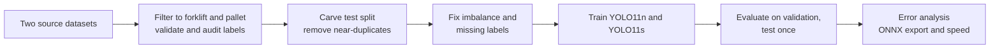

# Forklift and Pallet Detection (YOLO11)

Detect **forklifts** and **pallets** in warehouse images and video. For every object the model returns a class, a bounding box and a confidence score.

Built as a take-home task for an AI Engineer role. The focus is the part that decides accuracy in real projects: **data quality, honest evaluation and clear limits**, not only the model.

<!-- Add one or two result images here, for example assets/predictions.png (from notebook section 7) -->

## Why this matters

| Use case | How a detector helps |
| --- | --- |
| Safety | Warn when a forklift enters a walking zone |
| Automation | Guide autonomous forklifts to the right pallet |
| Inventory | Count pallets without manual stock checks |
| Efficiency | Measure forklift use and dock activity |

The task is **object detection** (what is where), not classification (one label per image) and not segmentation (pixel masks): boxes are enough for counting, zones and tracking, and they are far cheaper to label.

## Results

Held-out test set, 187 images. The model was chosen on validation, and the test set was used once.

| Model | Split | mAP@50 | mAP@50-95 | Precision | Recall |
| --- | --- | --- | --- | --- | --- |
| YOLO11n | val | 0.851 | 0.468 | 0.911 | 0.769 |
| YOLO11n | test | 0.883 | 0.531 | 0.863 | 0.799 |
| YOLO11s | val | 0.858 | 0.474 | 0.881 | 0.817 |
| YOLO11s | test | 0.856 | 0.512 | 0.822 | 0.812 |

Per class, test AP@50 (YOLO11s): forklift 0.868, pallet 0.844.
ONNX on CPU: 134 ms per image (7.5 FPS), mAP@50-95 0.501 against 0.512 in PyTorch.

<!-- UPDATE: these numbers come from the first training run (640 px, 60 epochs, no class balancing). Replace them with the output of the final run of the notebook. -->

The two sizes are within noise of each other on a test set this small (about 100 forklift boxes), so YOLO11n is the better value for speed.

**Error analysis** (YOLO11s, test, confidence 0.25, IoU 0.5): 1,020 correct detections, 349 false alarms, 198 missed objects, and no forklift/pallet confusion. Missed objects are small (median area 0.16% of the image against 0.42% for all boxes). Many false alarms are probably real pallets that were never labeled, which is the main weakness of the data (see below).

## Approach



### Data

| Source | Images | Classes | Notes |
| --- | --- | --- | --- |
| Warehouse dataset (Roboflow Universe) | 1,075 | forklift, pallet, pallet_truck, small_load_carrier, stillage | 11,776 pallet boxes but only 5 forklift boxes in train |
| Forklift dataset (Kaggle) | 1,011 | forklift, person | 1,000 forklift boxes in train, no pallets |

After merging, filtering and near-duplicate removal: **1,660 train / 213 validation / 187 test** images.

Filtering rules (the original datasets are never modified):

- Keep only `forklift` (id 0) and `pallet` (id 1). Names are matched exactly, so `pallet_truck` is never mistaken for `pallet`.
- Boxes of the removed classes are deleted, so those objects become background. The model learns that they are not forklifts or pallets.
- Images with only removed classes are hard negatives. Only a capped sample is kept (80 images), because a pallet under a stillage may be unlabeled in the source.
- Images with empty or missing labels, or unreadable files, are dropped.
- Polygons are converted to YOLO boxes, and the output is verified from disk (image/label pairs, class ids, box ranges, counts, `data.yaml`).
- Audit sheets (`audit_negatives.png`, `audit_overlaps.png`) and CSV reports are written for a visual review.

### Split hygiene

The sources have no usable test split, so one is carved from the pooled train data. Near-identical frames are grouped with a difference hash and stay together, and near-duplicates are then removed between train and validation or test (21 from train, 2 from validation). Without this, a test twin of a training image makes the score look better than it is.

### Two data problems and the fixes

| Problem | Evidence | Fix |
| --- | --- | --- |
| Class imbalance | about 11 pallet boxes per forklift box in train (10,347 and 905) | Repeat forklift images up to 3 times, evaluate each class separately |
| Labels missing across sources | The forklift dataset has no pallet labels, the warehouse dataset has 5 forklift labels | Self-training: a first model adds confident (0.6 or more) labels to the train split only, and a sample is checked by eye |

Validation and test labels are never changed.

### Model and training

- **Model:** Ultralytics YOLO11n and YOLO11s, fine-tuned from COCO weights (transfer learning). YOLO11 is a single-stage, anchor-free detector, which gives real-time speed and a simple ONNX export.
- **Settings:** 768 px images, up to 80 epochs, early stopping, cosine learning rate, mosaic off for the last 10 epochs, no vertical flip, fixed seed.
- **Selection:** the model and the confidence threshold are chosen on validation. The test set is used once.

### Evaluation

Precision, recall, mAP@50 and mAP@50-95, reported per class. The notebook also builds a confusion matrix at the chosen confidence threshold (the one Ultralytics draws uses a very low threshold and is flooded with background false alarms), a per-source table, and images of the worst predictions.

## Repository

```
.
├── forklift_pallet_detection.ipynb   # full pipeline: data, training, evaluation, export
├── prepare_two_class_dataset.py      # standalone version of the data preparation step
├── assets/                           # figures used in this README
└── README.md
```

## How to run

The notebook is written for **Kaggle**.

1. Create a Kaggle notebook and turn on a **GPU** accelerator and **Internet**.
2. Add the two datasets with **Add data** (the Roboflow warehouse dataset and the forklift dataset, YOLOv8 format).
3. Upload `forklift_pallet_detection.ipynb` and run all cells. Settings (image size, epochs, oversampling, pseudo-labels) are in the Config cell.
4. Outputs go to `/kaggle/working`: the processed dataset, `runs/` with weights and plots, the ONNX model, and `results.csv`.

Locally, install `ultralytics onnx onnxslim onnxruntime` and set the dataset paths in the data preparation step.

## Limitations

- **Domain shift:** public images differ from a real warehouse in angle, lighting and pallet types. The scores are not a production guarantee. Next step: label a few hundred real frames and fine-tune.
- **Carved test split:** it comes from the training data. Near-duplicates are removed, but frames from the same site still share lighting and layout, so the numbers are optimistic for a new site.
- **Partial labels:** each source labels mostly one class. Pseudo-labels are model guesses, so a person should review a sample. Validation and test are not corrected, so false alarms on unlabeled objects still count against the model there.
- **Source shortcut:** because each class comes mostly from one dataset, the model may use the look of a source as a cue. The notebook measures results per source, but a mixed-scene test set labeled by hand would settle it.
- **Similar equipment:** pallet trucks, stillages and small load carriers are treated as background and can still be confused with the target classes.
- **2D boxes only:** no distance or approach angle. Autonomous use needs a depth camera or LiDAR as well.
- **Small dataset:** per-class scores can swing by several points.

## Next steps

1. Label real frames from the target cameras and review the pseudo-labels.
2. Active learning on low-confidence frames.
3. Validate on representative warehouse data before any deployment.
4. Optimize for the target hardware (for example INT8 quantization), then wrap the model in an inference service (for example FastAPI).
5. Tracking (ByteTrack) and zone rules on top of the detector.

## Credits and licenses

- Warehouse dataset (Roboflow Universe): []
- Forklift dataset (Kaggle): []
- [Ultralytics YOLO11](https://github.com/ultralytics/ultralytics) is licensed under AGPL-3.0, so commercial use needs a license review.
- Check each dataset license before reuse.

## Author

Rana Nasser, Computer Science, Ain Shams University.
